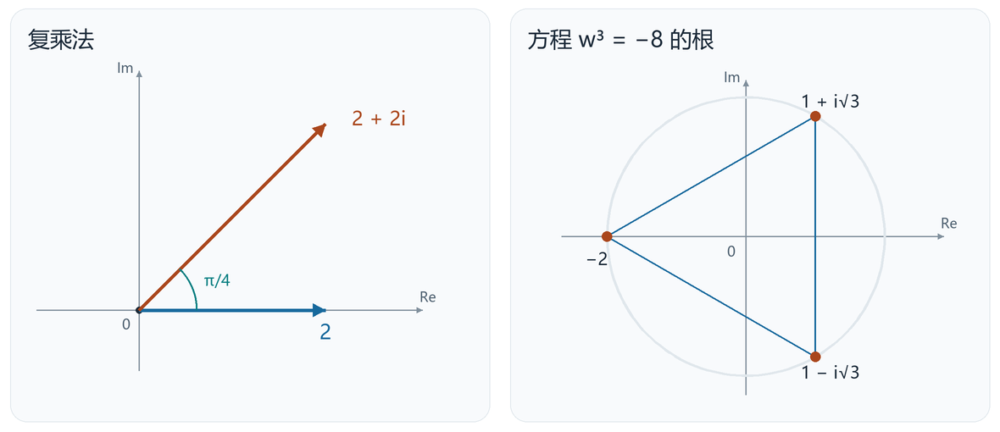
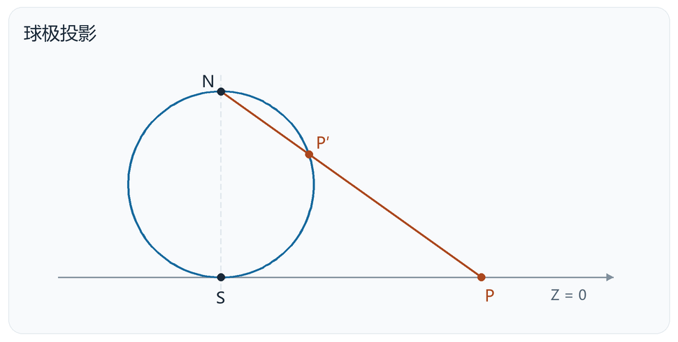
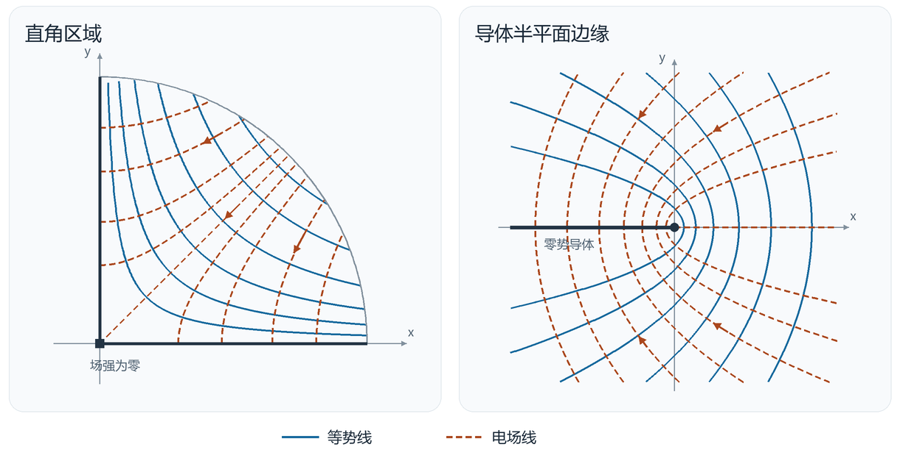
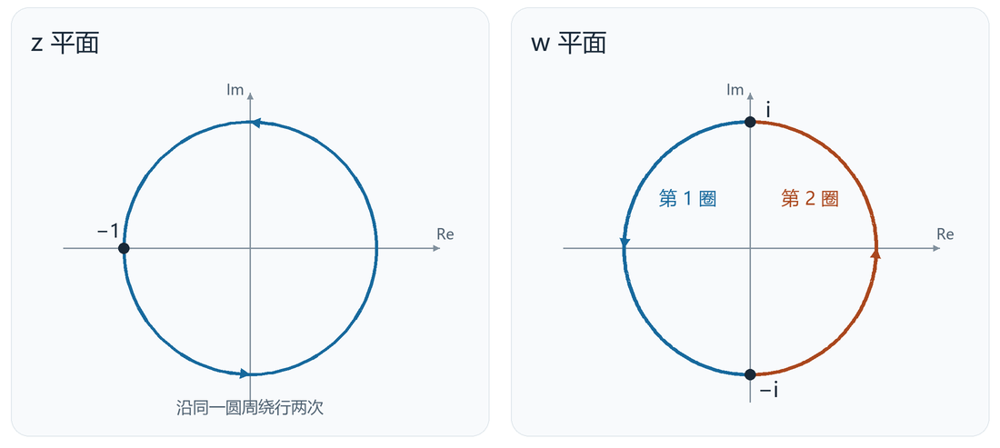
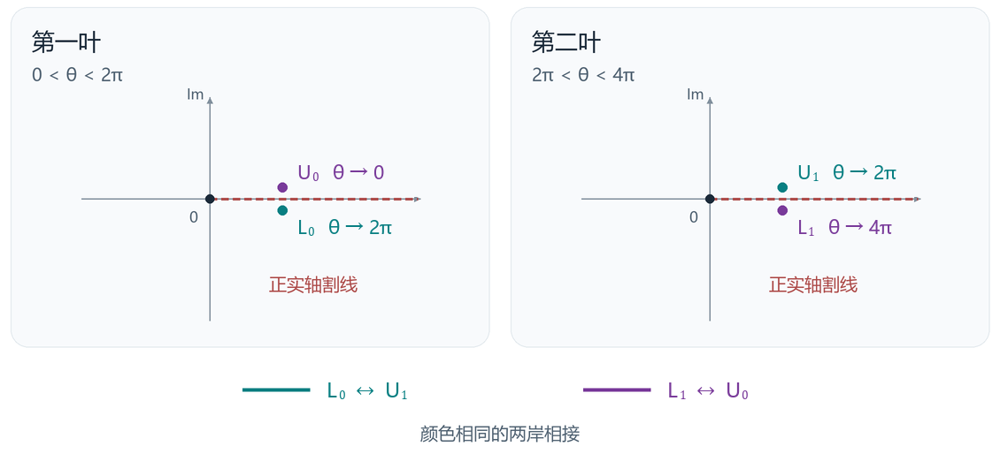

平面无电荷区域里的静电势满足拉普拉斯方程。若还想知道电场线的形状，可以在同一张图上再画一族曲线，使它们处处沿电场方向。两族曲线之间有怎样的关系？复变函数把这两个问题联系起来。一个复函数有实部和虚部，若它在复数意义下可导，这两个分量的变化便受到同一组方程约束。在适当条件下，一个分量可以表示电势，另一个分量的等值线恰好沿电场方向。

本章从复数乘法的几何意义出发，建立复极限与复导数，进而讨论解析函数的局部几何、平面场和多值函数的解析分支。所需的数学基础包括平面向量、二元函数的偏导数与全微分、梯度和曲线积分。正文页码定位以 2024 年“101 计划”改编本为准，见[本章资料](#chapter-01-sources)。

## §1.1　复数与复数运算

把平面向量写成一对实数，已经足以完成加减。若希望用一次乘法同时表达旋转和伸缩，就需要给这对实数赋予进一步的运算结构。本节从这个角度建立复数的运算，并说明如何用同一套符号描述角度、距离与面积。

### MMP-01-01-01　复平面、模、辐角与共轭

复数 $z=x+iy$ 由两个实数 $x,y$ 确定，其中 $i^2=-1$。写作 $\operatorname{Re}z=x$、$\operatorname{Im}z=y$。在复平面上，$z$ 对应点 $(x,y)$，也可视为从原点指向该点的向量。横轴为实轴，纵轴为虚轴。点到原点的距离是**模** $|z|=\sqrt{x^2+y^2}$。对两点 $z,w$，距离为 $|z-w|$。

当 $z\ne0$ 时，若 $x=r\cos\theta$、$y=r\sin\theta$ 且 $r=|z|$，则 $\theta$ 是 $z$ 的一个**辐角**。满足这两个等式的角构成集合

$$
\arg z=\{\theta+2k\pi:k\in\mathbb Z\}.
$$

本章用 $\operatorname{Arg}_{[0,2\pi)}z$ 表示落在 $[0,2\pi)$ 中的唯一代表值。改编本在叙述中分别用 $\operatorname{Arg}z$、$\arg z$ 表示多值辐角和主值，本章在主值符号上显式标出取值区间。比如 $z=-1+i$ 位于第二象限，所选辐角为 $3\pi/4$。比值 $y/x$ 只能确定正切值。求辐角还要用 $x,y$ 的符号判断象限，$x=0$ 时直接按虚轴上的位置确定角度。原点没有辐角。

记 $e^{i\theta}=\cos\theta+i\sin\theta$，便有代数式、三角式与指数式

$$
z=x+iy=r(\cos\theta+i\sin\theta)=re^{i\theta}.
$$

$\bar z=x-iy$ 称为 $z$ 的**共轭**，在几何上把点关于实轴反射。由乘法展开可得 $z\bar z=x^2+y^2=|z|^2$。例如 $i^2=-1$，而 $|i|^2=1$。

**教材核对。** 改编本第 4 页式 (1.1.2) 的反正切写法需要补充象限与虚轴条件。上面的定义用正弦、余弦共同确定辐角，从而适用于所有非零复数。

### MMP-01-01-02　四则运算、旋转伸缩与开根

令 $z_j=x_j+iy_j$（$j=1,2$）。加减逐分量进行。乘法按分配律展开，再代入 $i^2=-1$，得到

$$
\begin{aligned}
z_1\pm z_2&=(x_1\pm x_2)+i(y_1\pm y_2),\\
z_1z_2&=(x_1x_2-y_1y_2)+i(x_1y_2+y_1x_2).
\end{aligned}
$$

当 $z_2\ne0$ 时，$z_2\bar z_2=|z_2|^2>0$，故 $z_2^{-1}=\bar z_2/|z_2|^2$，于是

$$
\frac{z_1}{z_2}=\frac{z_1\bar z_2}{|z_2|^2}
=\frac{x_1x_2+y_1y_2}{x_2^2+y_2^2}
+i\frac{x_2y_1-x_1y_2}{x_2^2+y_2^2}.
$$

加法对应向量叠加，因此 $|z_1+z_2|\le |z_1|+|z_2|$。把 $z_1$ 写成 $(z_1-z_2)+z_2$，可得 $|z_1|-|z_2|\le |z_1-z_2|$。交换两个点，再合并这两个估计，得到

$$
\bigl||z_1|-|z_2|\bigr|\le |z_1-z_2|.
$$

对非零的 $z_j=r_j e^{i\theta_j}$，三角函数加法公式给出 $e^{i\theta_1}e^{i\theta_2}=e^{i(\theta_1+\theta_2)}$，故

$$
z_1z_2=r_1r_2e^{i(\theta_1+\theta_2)},\qquad
\frac{z_1}{z_2}=\frac{r_1}{r_2}e^{i(\theta_1-\theta_2)}.
$$

因此乘以固定的 $a=\rho e^{i\alpha}\ne0$，会把每个向量的长度乘以 $\rho$，并沿逆时针方向旋转 $\alpha$。例如 $(1+i)\cdot 2=2+2i$，模从 $2$ 变为 $2\sqrt2$，角度增加 $\pi/4$。

对非零复数 $z=re^{i\theta}$ 与整数 $n$，反复使用乘法公式或取倒数便得到 $z^n=r^n e^{in\theta}$。现在取正整数 $n$，反过来解 $w^n=z$。写 $w=se^{i\phi}$，则 $s^n=r$ 且 $n\phi=\theta+2k\pi$。因此所有根为

$$
w_k=r^{1/n}\exp\!\left(i\frac{\theta+2k\pi}{n}\right),\qquad k=0,\dots,n-1.
$$

任意两个不同的列出角相差 $2\pi/n$ 的非零整数倍，且其差的绝对值小于 $2\pi$，所以这些根互异。其余整数 $k$ 只会重复这些根。几何上它们均匀分布在半径为 $r^{1/n}$ 的圆周上。当 $z=0$ 时，$w^n=0$ 只有 $w=0$ 一个取值。

**例。** 解 $w^3=-8$。取 $r=8$、$\theta=\pi$，三个根的模均为 $2$，辐角为 $\pi/3,\pi,5\pi/3$，因而根为 $1+i\sqrt3$、$-2$、$1-i\sqrt3$。

*图 1.1　左图以 $z=2$ 展示乘以 $1+i$ 的效果。右图中三个根等距排列，相邻根的辐角相差 $2\pi/3$。*

### MMP-01-01-03　点积、有向面积与复数表示

设 $\mathbf a=(x_1,y_1)$、$\mathbf b=(x_2,y_2)$ 对应 $z_1,z_2$。由乘法公式可得

$$
\bar z_1z_2=\mathbf a\cdot\mathbf b+i\det(\mathbf a,\mathbf b),\qquad
\det(\mathbf a,\mathbf b)=x_1y_2-y_1x_2.
$$

实部给出点积，虚部给出以 $\mathbf a,\mathbf b$ 为邻边的有向平行四边形面积。因此三角形 $(0,z_1,z_2)$ 的有向面积为 $\tfrac12\operatorname{Im}(\bar z_1z_2)$。交换顶点次序会改变符号，取绝对值才得到几何面积。例如 $z_1=2$、$z_2=1-i$ 给出有向面积 $-1$，几何面积为 $1$。

对依次连接顶点 $z_1,\dots,z_m$ 形成的简单多边形，令 $z_{m+1}=z_1$，有向面积为

$$
A_{\mathrm{or}}=\frac12\sum_{j=1}^m\operatorname{Im}(\bar z_j z_{j+1}).
$$

由平面格林公式，逆时针边界给出 $2A_{\mathrm{or}}=\oint(x\,dy-y\,dx)$。在一条从 $(x_j,y_j)$ 到 $(x_{j+1},y_{j+1})$ 的边上，令 $x=x_j+t(x_{j+1}-x_j)$、$y=y_j+t(y_{j+1}-y_j)$，$0\le t\le1$。代入后含 $t$ 的项相消，该边积分等于 $x_jy_{j+1}-y_jx_{j+1}$。把各边所得结果相加即得上式，原点取在多边形外时公式也成立。

**教材核对。** 改编本第 7 页式 (1.1.26) 和 (1.1.27) 的符号由顶点取向决定。取几何面积时应对有向结果取绝对值。

### MMP-01-01-04　扩充复平面与球极投影

若只关心 $z$ 是否远离原点，可以用一个新点 $\infty$ 表示所有满足 $|z|\to\infty$ 的趋近过程。集合 $\widehat{\mathbb C}=\mathbb C\cup\{\infty\}$ 称为**扩充复平面**，其几何模型是黎曼球面。

在三维坐标 $(X,Y,Z)$ 中，取球面 $X^2+Y^2+(Z-1)^2=1$，它在南极 $S=(0,0,0)$ 与平面 $Z=0$ 相切。由北极 $N=(0,0,2)$ 向平面上的点 $P=(x,y,0)$ 作直线。除北极之外，此直线与球面的交点 $P'$ 对应 $z=x+iy$。为求 $P'$，把直线写成 $(tx,ty,2(1-t))$。代入球面方程后得 $t[(r^2+4)t-4]=0$，其中 $r=|z|$。取非零解可得

$$
P'=\left(\frac{4x}{r^2+4},\frac{4y}{r^2+4},\frac{2r^2}{r^2+4}\right).
$$

反过来，从任一球面点 $P'\ne N$ 出发，过 $N$ 和 $P'$ 的直线与复平面有唯一交点。无论 $z$ 从哪个方向离开原点，只要 $r\to\infty$，上式的第一、二分量便趋于零，第三分量趋于 $2$。因此可把北极对应到 $\infty$。在它附近使用坐标 $\zeta=1/z$，则 $z\to\infty$ 等价于 $\zeta\to0$。§1.6 将用这个坐标研究平方根在无穷远的分支行为。

*图 1.2　过北极 $N$ 和平面点 $P$ 的直线在球面上得到对应点 $P'$。图中平面仅画出该截面内的一条轴。*

## §1.2　复变函数

复数的模把平面上的接近程度写成一个实数。借助这个距离，可以精确定义复函数的极限，并判断由两个实值分量组成的映射何时连续。

### MMP-01-02-01　单值函数与平面映射

设 $E\subseteq\mathbb C$。对每个 $z\in E$ 指定唯一一个 $w\in\mathbb C$，便得到单值复变函数 $f:E\to\mathbb C$，写作 $w=f(z)$。若 $z=x+iy$，可写

$$
f(x+iy)=u(x,y)+iv(x,y).
$$

于是 $f$ 在几何上是从 $z$ 平面到 $w$ 平面的映射 $(x,y)\mapsto(u,v)$。例如 $f(z)=z^2$ 对应 $(u,v)=(x^2-y^2,2xy)$。在极坐标中，它把 $re^{i\theta}$ 送到 $r^2e^{2i\theta}$。角度加倍和半径平方共同解释了为什么 $z$ 与 $-z$ 在该映射下有相同的像。反求 $w$ 的平方根时，要记录所有原像。教材沿用“多值函数”这一术语，§1.6 将用**分支**把这种对应在适当区域内写成单值函数。

### MMP-01-02-02　邻域、区域与边界

以 $z_0$ 为中心、半径 $r>0$ 的开圆盘是 $D(z_0,r)=\{z:|z-z_0|<r\}$。去掉中心便得到去心圆盘。若某个 $D(z_0,r)$ 含于集合 $E$，$z_0$ 是 $E$ 的内点。若某个这样的圆盘含于补集，$z_0$ 是外点。若任意这样的圆盘同时遇到 $E$ 和其补集，$z_0$ 属于边界 $\partial E$。闭包 $\overline E=E\cup\partial E$。

复平面中的**区域**是非空、开且连通的集合。开集的每个点都有一个完全落在集合内的开圆盘。在复平面中的开集上，连通等价于任意两点可由集合内的折线连接。事实上，从一固定点出发能经折线到达的点形成相对开集，因为每到达一点，便可以在其邻域内加上一段直线。补集用同样理由也是相对开集，连通性使补集为空。

例如 $D(0,1)$ 和圆环 $\{z:1<|z|<2\}$ 都是区域。圆环有两条边界圆周，中间的孔会改变闭路积分与原函数的存在条件。第 2 章将用积分区分这种整体差别。

### MMP-01-02-03　复极限与连续性

设 $z_0$ 是 $E$ 的聚点，即每个去心圆盘都含有 $E$ 中的点。记 $\lim_{z\to z_0,\ z\in E}f(z)=L$，若对每个 $\varepsilon>0$ 都存在 $\delta>0$，使得 $z\in E$ 且 $0<|z-z_0|<\delta$ 时有 $|f(z)-L|<\varepsilon$。

若 $L=a+ib$，则复极限等价于 $(x,y)\to(x_0,y_0)$ 时同时有 $u\to a$、$v\to b$。一方面，$|u-a|$ 和 $|v-b|$ 各自不超过 $|f-L|$。另一方面，若两个分量的误差都小于 $\varepsilon/2$，由 $|f-L|\le|u-a|+|v-b|$ 便得到所需估计。当 $z_0\in E$ 时，$f$ 在 $z_0$ 连续的条件是，对任意 $\varepsilon>0$，$E$ 中所有充分接近 $z_0$ 的点都满足 $|f(z)-f(z_0)|<\varepsilon$。在聚点处，这等价于极限等于函数值。

**例。** 对 $f(z)=\bar z/z$（$z\ne0$），沿实轴到原点时 $f(z)=1$，沿虚轴到原点时 $f(z)=-1$，故极限不存在。若要证明某个复极限存在，需要对所有充分小的增量取得同一个估计。例如 $|z^2|=|z|^2$ 直接给出 $\lim_{z\to0}z^2=0$。若研究 $z\to\infty$，可用 §1.1 的 $\zeta=1/z$ 把问题转到原点。

### MMP-01-02-04　基本初等函数

多项式在整个复平面上有定义。有理函数 $P(z)/Q(z)$ 的自然定义域排除 $Q$ 的零点。把实指数函数与单位圆的参数式组合，定义

$$
e^{x+iy}=e^x(\cos y+i\sin y).
$$

由实指数的加法性质和复数乘法可得 $e^{z+w}=e^ze^w$。它的模为 $e^x$，故从不取零。如果 $e^{z+T}=e^z$，则 $e^T=1$。比较模和辐角可知，$T$ 的实部为零，虚部为 $2\pi$ 的整数倍。反之，这些平移都保持函数值，故其非零周期为 $2k\pi i$，其中 $k$ 是非零整数。

在复平面上定义

$$
\begin{aligned}
\cos z&=\frac{e^{iz}+e^{-iz}}2,& \sin z&=\frac{e^{iz}-e^{-iz}}{2i},\\
\cosh z&=\frac{e^z+e^{-z}}2,& \sinh z&=\frac{e^z-e^{-z}}2.
\end{aligned}
$$

$\sin z,\cos z$ 具有实周期 $2\pi$，$\sinh z,\cosh z$ 具有纯虚周期 $2\pi i$。将 $z=x+iy$ 代入指数定义，分别合并 $e^y,e^{-y}$ 的和与差，得到

$$
\sin(x+iy)=\sin x\cosh y+i\cos x\sinh y,\qquad
\cos(x+iy)=\cos x\cosh y-i\sin x\sinh y.
$$

于是 $|\sin(x+iy)|^2=\sin^2x+\sinh^2y$，$|\cos(x+iy)|^2=\cos^2x+\sinh^2y$。例如 $\cos(iy)=\cosh y$，其模随 $|y|$ 增大而增长。因此实轴上的界 $|\cos x|\le1$ 仅适用于实变量。

当 $z=re^{i\theta}\ne0$ 时，求解 $e^w=z$。若 $w=a+ib$，比较模得到 $e^a=r$，比较辐角得到 $b=\theta+2k\pi$。**复对数**的全部值为

$$
\log z=\{\ln r+i(\theta+2k\pi):k\in\mathbb Z\}.
$$

这里 $\ln r$ 是正实数的自然对数。例如 $\log(-1)=\{(2k+1)\pi i:k\in\mathbb Z\}$。给定 $s\in\mathbb C$，从每个对数值 $L\in\log z$ 形成 $e^{sL}$，便得到 $z^s$ 的各个可能取值。相邻两个对数值给出的幂相差一个乘因子 $e^{2\pi i s}$。当 $s$ 为整数时各值相同，当 $s=1/n$ 时重得 §1.1 的 $n$ 次根。要对对数或一般复幂求导，须先在相应开域上选定单值分支。

## §1.3　导数

实变量差商只涉及数轴上的增量。复变量可以从平面上任意方向趋近，差商的极限对所有这些增量须有同一个值。这一要求把两个实值分量的导数联系起来。

### MMP-01-03-01　复差商与求导规则

设 $f:D\to\mathbb C$，$D$ 是开集且 $z_0\in D$。若极限

$$
f'(z_0)=\lim_{h\to0}\frac{f(z_0+h)-f(z_0)}h
$$

存在且有限，则 $f$ 在 $z_0$ **复可导**。等价地，存在 $a\in\mathbb C$ 使

$$
f(z_0+h)=f(z_0)+ah+o(|h|),\qquad a=f'(z_0).
$$

这里 $o(|h|)$ 表示其模除以 $|h|$ 后趋于零的误差。从增量趋于零可知复可导蕴含连续。和、差、积、商与复合的求导公式沿用差商推导。以乘积为例，缩写 $F=f(z_0+h)$、$F_0=f(z_0)$、$G=g(z_0+h)$、$G_0=g(z_0)$，有

$$
\frac{FG-F_0G_0}{h}=G\frac{F-F_0}{h}+F_0\frac{G-G_0}{h}.
$$

利用 $G\to G_0$ 即得 $(fg)'=f'g+fg'$。差商的线性性给出 $(f\pm g)'=f'\pm g'$。若 $g(z_0)\ne0$，连续性保证 $g$ 在足够小的邻域内也非零。将 $1/g$ 的差商通分，即得 $(1/g)'=-g'/g^2$，再用乘积法则得到 $(f/g)'=(f'g-fg')/g^2$。整数幂的导数 $(z^n)'=nz^{n-1}$ 由乘积和倒数法则得到，其中 $n<0$ 时要求 $z\ne0$，$n=0$ 的常函数导数为零。

链式法则 $(F\circ g)'(z_0)=F'(g(z_0))g'(z_0)$ 可由两次代入一阶展开得到，因为 $g(z_0+h)-g(z_0)=O(|h|)$。若局部反函数在 $f(z_0)$ 处复可导，由链式法则得到 $(f^{-1})'(f(z_0))=1/f'(z_0)$。当 $f$ 在 $z_0$ 的邻域内实连续可微，且在 $z_0$ 处的复导数非零时，实反函数定理给出实连续可微的局部反函数。由 [MMP-01-03-03](#mmp-01-03-03) 的判据可验证该反函数在 $f(z_0)$ 处复可导。

**例。** $f(z)=z^2$ 的差商为 $2z_0+h$，故 $f'(z_0)=2z_0$。若 $f(z)=\bar z$，差商为 $\bar h/h$，沿实增量为 $1$，沿纯虚增量为 $-1$。因此共轭映射处处连续而处处复不可导。

### MMP-01-03-02　柯西–黎曼方程的必要性

写 $f=u+iv$，以下偏导数均在 $(x_0,y_0)$ 取值。若 $f'(z_0)$ 存在，取实增量 $h=\Delta x$，由差商得

$$
f'(z_0)=u_x+iv_x.
$$

取纯虚增量 $h=i\Delta y$，用 $1/i=-i$，得 $f'(z_0)=v_y-iu_y$。由于同一个导数同时等于这两个值，比较实部与虚部便有**柯西–黎曼方程**

$$
u_x=v_y,\qquad u_y=-v_x. \tag{1.1}
$$

单点的四个偏导数存在并满足式 (1.1)，只能保证上述两条坐标轴路径给出相同差商极限。取改编本 §1.3 的例子 $g(x+iy)=\sqrt{xy}$，约定被开方数非负时取非负实根，被开方数为负时取正虚根。沿两条坐标轴 $g=0$，因此四个偏导数在原点均为零。沿 $h=t(1+i)$、$t>0$，有 $g(h)=t$，差商等于 $1/(1+i)$。这条路径的结果与沿轴所得的零不同，所以 $g'(0)$ 不存在。

### MMP-01-03-03　实全微分与复可导的充要判据

**点态判据。** $f=u+iv$ 在 $z_0$ 复可导，当且仅当 $(u,v)$ 作为二元实映射在 $(x_0,y_0)$ 实可微，并且满足式 (1.1)。实可微在这里指存在一个实线性映射，能以 $o(|h|)$ 的误差近似函数的增量。

必要性来自复导数的一阶展开。若 $a=f'(z_0)=\alpha+i\beta$，乘以 $a$ 给出实线性变换

$$
\begin{pmatrix}\Delta x\\\Delta y\end{pmatrix}
\longmapsto
\begin{pmatrix}\alpha&-\beta\\\beta&\alpha\end{pmatrix}
\begin{pmatrix}\Delta x\\\Delta y\end{pmatrix}.
$$

因此实全微分存在，其矩阵分量满足式 (1.1)。反过来，若实全微分存在，令 $h=\Delta x+i\Delta y$，便有

$$
\begin{aligned}
f(z_0+h)-f(z_0)
&=(u_x+iv_x)\Delta x+(u_y+iv_y)\Delta y+o(|h|)\\
&=(u_x+iv_x)(\Delta x+i\Delta y)+o(|h|).
\end{aligned}
$$

第二行使用了 $u_y+iv_y=-v_x+iu_x=i(u_x+iv_x)$。除以 $h$ 后误差仍趋于零，足以控制所有趋近方式，故 $f'(z_0)=u_x+iv_x$。在一个开域内，若实、虚部具有连续一阶偏导数且处处满足式 (1.1)，便可逐点使用该判据。雅可比矩阵的逆若存在，对应乘以 $1/a$，这也给出了前一节点的逆映射求导公式。

**教材核对。** 改编本第 12–13 页把偏导连续性和柯西–黎曼方程合称为可导的充要条件。偏导在邻域内存在并在该点连续可保证该点实可微。点态的充要判据如上。作为检验，可取 $f(0)=0$，$f(z)=z^2\sin(1/|z|^2)$（$z\ne0$）。由 $|f(z)/z|\le|z|$，知 $f'(0)=0$。沿实轴，实部的 $x$ 偏导为 $2x\sin(1/x^2)-2\cos(1/x^2)/x$，在原点附近无界。

**例。** 由 $e^{x+iy}=e^x\cos y+i e^x\sin y$，可算出 $u_x=u=v_y$、$v_x=v=-u_y$，两分量均光滑，故 $(e^z)'=u_x+iv_x=e^z$。再用链式法则和 §1.2 的指数表示，得到 $(\sin z)'=\cos z$、$(\cos z)'=-\sin z$、$(\sinh z)'=\cosh z$、$(\cosh z)'=\sinh z$。

### MMP-01-03-04　极坐标中的柯西–黎曼方程

在 $r>0$ 的局部极坐标中，$z=re^{i\theta}$，有 $\partial_r z=e^{i\theta}$、$\partial_\theta z=ir e^{i\theta}$。若 $f$ 复可导，代入一阶展开得到 $\partial_r f=f'(z)e^{i\theta}$、$\partial_\theta f=ir\,\partial_r f$。比较实部与虚部，得

$$
u_r=\frac1r v_\theta,\qquad v_r=-\frac1r u_\theta. \tag{1.2}
$$

反过来，当 $u,v$ 在局部极坐标中实可微时，式 (1.2) 表明两个坐标方向的像以乘同一个复数的方式得到。因为 $e^{i\theta}$ 和 $ir e^{i\theta}$ 在 $r>0$ 时构成实平面的基，整个实全微分都是复乘法，故 $f$ 复可导。极坐标在原点退化，需要回到复差商或直角坐标取极限。

**教材核对。** 改编本第 13 页用增量符号表示沿角方向的变化。上面的 $ir e^{i\theta}$ 是偏导数。固定 $r$ 时，有限角增量满足 $\Delta z=ir e^{i\theta}\Delta\theta+o(|\Delta\theta|)$。

**例。** 在能够连续取 $\theta$ 的局部极坐标区域内，令 $f=\ln r+i\theta$。有 $u_r=1/r$、$v_\theta=1$、$u_\theta=v_r=0$，式 (1.2) 成立，故 $f'(z)=e^{-i\theta}\partial_r f=e^{-i\theta}/r=1/z$。§1.6 将说明这个公式对定义域的要求。

## §1.4　解析函数

一个函数即使在某点有复导数，也可能在该点周围处处失去这一性质。解析函数要求复可导性在开邻域内成立。本节考察这种邻域条件如何约束实部和虚部，以及它在平面几何上的含义。

### MMP-01-04-01　点上可导与邻域解析

若存在 $z_0$ 的一个开邻域，$f$ 在其中处处复可导，就称 $f$ 在 $z_0$ **解析**。若 $f$ 在区域 $D$ 中每一点都解析，就称 $f$ 在 $D$ 解析，亦称在 $D$ **全纯**。因为 $D$ 是开集，在 $D$ 全纯等价于在 $D$ 处处复可导。若 $D=\mathbb C$，称 $f$ 为整函数。多项式、指数函数以及复三角函数都是整函数。有理函数在其分母非零处解析。

**例。** $f(z)=|z|^2$ 的实、虚部分别为 $x^2+y^2$ 和 $0$。柯西–黎曼方程要求 $2x=2y=0$，因此唯一的复可导点是原点。此处 $|h|^2/h=\bar h\to0$，故导数为零。原点的每个邻域都包含复不可导点，所以 $f$ 处处不解析。

### MMP-01-04-02　调和函数和正交等值线

若实值函数 $u$ 在 $D$ 有连续二阶偏导数，且

$$
\Delta u=u_{xx}+u_{yy}=0,
$$

则称 $u$ 在 $D$ 上**调和**。设 $f=u+iv$ 在 $D$ 解析。第 2 章将由柯西积分公式推出解析函数具有各阶导数，因而这里可使用 $u,v$ 的连续二阶偏导数。对式 (1.1) 的两式求导，利用混合偏导可交换，得到

$$
\Delta u=v_{yx}-v_{xy}=0,\qquad
\Delta v=-u_{yx}+u_{xy}=0.
$$

这样获得的 $v$ 称为 $u$ 的**共轭调和函数**。柯西–黎曼方程还给出 $\nabla v=(-u_y,u_x)$，即 $\nabla v$ 由 $\nabla u$ 逆时针旋转 $\pi/2$ 得到。当 $f'(z)\ne0$ 时，两个梯度都非零。过该点的两条等值线分别以这两个梯度为法向，由隐函数定理可知，它们是局部光滑曲线且相互正交。在临界点 $f'(z)=0$，等值线可能分叉，需要另外分析。

**例。** $f(z)=z^2$ 给出 $u=x^2-y^2$、$v=2xy$。当 $(x,y)\ne(0,0)$ 时，梯度 $(2x,-2y)$ 与 $(2y,2x)$ 都非零且点积为零。在原点，两条直线 $y=\pm x$ 都属于 $u=0$，两条坐标轴都属于 $v=0$。这里每个零等值集都由相交的两条直线组成。§1.5 将用同一对函数构造满足导体边界的电势。

### MMP-01-04-03　由一个分量求共轭调和函数

已知一个调和函数 $u$，可将寻找 $v$ 化为求微分式的势函数。由柯西–黎曼方程，所求的 $v$ 应满足

$$
dv=-u_y\,dx+u_x\,dy. \tag{1.3}
$$

设右端记为 $P\,dx+Q\,dy$。因为 $Q_x-P_y=u_{xx}+u_{yy}=0$，这个微分式是闭的。二元微积分中的路径无关定理表明，在小圆盘上，或更一般地在单连通区域上，闭式的曲线积分只依赖端点。单连通在这里要求区域中的任意闭路都能在区域内连续收缩到一点。固定基点并对式 (1.3) 积分，可得 $v$，且 $v_x=P$、$v_y=Q$。实、虚部具有连续一阶偏导并满足柯西–黎曼方程，因此 $u+iv$ 解析。若两个共轭都定义在同一连通区域，它们的差的梯度为零，所以相差一个实常数。

**例一。** 取 $u=x^2-y^2$。此时 $dv=2y\,dx+2x\,dy$，可用以下三种计算。

1. **曲线积分。** 从 $(0,0)$ 沿横线到 $(x,0)$，第一段 $y=0$、$dy=0$，积分为零。再沿竖线到 $(x,y)$，第二段积分为 $\int_0^y 2x\,d\eta=2xy$。
2. **辨认全微分。** 乘积求微分给出 $d(2xy)=2y\,dx+2x\,dy$，故 $v=2xy+C$。
3. **逐变量积分。** 先由 $v_y=2x$ 得 $v(x,y)=2xy+g(x)$，再由 $v_x=2y$ 得 $g'(x)=0$。

三种方法均给出 $f(z)=z^2+iC$，其中 $C\in\mathbb R$。

**例二。** 若给定虚部 $v=\sqrt{r-x}$，在区域 $D_+=\mathbb C\setminus[0,\infty)$ 上取 $0<\theta<2\pi$，其中 $r=|z|$。由于 $r-x=r(1-\cos\theta)=2r\sin^2(\theta/2)$，且 $\sin(\theta/2)>0$，有 $v=\sqrt{2r}\sin(\theta/2)$。由极坐标柯西–黎曼方程求实部的微分，得到

$$
\begin{aligned}
du&=\frac{v_\theta}{r}\,dr-rv_r\,d\theta\\
  &=\frac{\cos(\theta/2)}{\sqrt{2r}}\,dr
    -\frac{\sqrt{2r}}2\sin(\theta/2)\,d\theta\\
  &=d\bigl[\sqrt{2r}\cos(\theta/2)\bigr].
\end{aligned}
$$

所以 $f=\sqrt{2r}\,e^{i\theta/2}+C$，其去掉实常数后的平方为 $2z$。实部的余弦在上半平面为正，在下半平面为负，在负实轴上为零。**教材核对。** 改编本第 16–17 页例 2 的极坐标结果适用于上述取角范围。第 17 页将余弦项改写为非负根式 $\sqrt{r+x}$，这一步只适用于余弦非负的部分。由 $u-C=\sqrt{2r}\cos(\theta/2)$ 可直接读出各处的符号。

**补充推导。** 局部共轭可能无法在整个区域中选成单值。例如 $u=\ln|z|$ 在穿孔平面 $\mathbb C\setminus\{0\}$ 调和，而对应的式 (1.3) 为

$$
-\frac{y}{x^2+y^2}\,dx+\frac{x}{x^2+y^2}\,dy.
$$

沿逆时针单位圆 $x=\cos t$、$y=\sin t$，右端等于 $dt$，一周积分是 $2\pi$。若它等于某个全局单值函数的 $dv$，任何闭路积分都应为零。因此 $\ln|z|$ 在穿孔平面上无法取得全局单值共轭。改编本第 14–15 页利用了曲线积分的路径无关性，应用时须检验定义域或闭路积分条件。

### MMP-01-04-04　雅可比矩阵、局部伸缩与保角

设 $f$ 在 $z_0$ 解析，$a=f'(z_0)=\alpha+i\beta$。由 [MMP-01-03-03](#mmp-01-03-03)，映射 $(x,y)\mapsto(u,v)$ 在 $z_0$ 的雅可比矩阵为

$$
J_f(z_0)=\begin{pmatrix}\alpha&-\beta\\\beta&\alpha\end{pmatrix},
\qquad \det J_f(z_0)=|a|^2.
$$

若 $a\ne0$，矩阵等于一个旋转矩阵乘以正数 $|a|$。取两条经过 $z_0$ 的可微曲线 $\gamma_1(t)$、$\gamma_2(t)$，参数在交点处取 $t=0$，两条切向量均非零。链式法则给出像曲线的切向量 $(f\circ\gamma_j)'(0)=a\gamma_j'(0)$。两个向量同时旋转同一角度，并以相同比例伸缩，所以有向夹角保持不变。由此可见，解析函数在 $f'(z_0)\ne0$ 处局部保角。由非零雅可比行列式也可知它在该点附近局部可逆。

例如 $z^2$ 在 $z_0\ne0$ 处的局部伸缩比为 $2|z_0|$，旋转角为 $2z_0$ 的任一辐角。在原点，实轴正向射线与辐角为 $\pi/4$ 的射线分别映到实轴正向与虚轴正向，夹角由 $\pi/4$ 变为 $\pi/2$。改编本第 17–18 页式 (1.4.9)–(1.4.11) 所用的矩阵关系是全微分的关系。对有限增量，$\Delta f=f'(z_0)\Delta z+o(|\Delta z|)$ 给出它的精确含义。

## §1.5　平面标量场

电势、温度和速度势都是标量。若空间沿一个方向具有平移对称性，在其垂直截面上就能研究相应的平面场。几种不同物理过程之所以可以采用同一种复函数方法，是因为在适当的物理条件下，相应标量都满足二维拉普拉斯方程。

### MMP-01-05-01　二维静电势与复势

设均匀介质中有一平面静电区域 $D$，场量沿垂直截面的方向不变，且区域内无自由电荷。用 $\Phi(x,y)$ 表示静电势。静电关系 $\mathbf E=-\nabla\Phi$ 和高斯定律 $\nabla\cdot(\epsilon\mathbf E)=0$ 在介电常数 $\epsilon$ 恒定时给出 $\Delta\Phi=0$。由 §1.4，在小圆盘上或可取全局共轭的区域中，可以构造解析函数

$$
W(z)=\Phi(x,y)+i\Psi(x,y),
$$

称为**复势**。$\Phi=\text{常数}$ 描述等势线。因 $\nabla\Psi=(-\Phi_y,\Phi_x)$，有 $\nabla\Psi\cdot\mathbf E=0$。在场强非零处，$\Psi=\text{常数}$ 的曲线切向与 $\mathbf E$ 平行，因而它们给出电场线。箭头方向由 $\mathbf E=-\nabla\Phi$ 决定，沿箭头电势降低。导体边界的电势值来自物理边界条件，据此选取实际适用的复势与区域。

### MMP-01-05-02　有向通量与共轭函数的端点差

给定区域内从 $A$ 到 $B$ 的分段光滑曲线 $C$。在每个光滑段用弧长 $s$ 参数化，单位切向量为 $(dx/ds,dy/ds)$。取切向量逆时针旋转 $\pi/2$ 得到的**左法向** $\mathbf n=(-dy/ds,dx/ds)$。穿过该曲线的单位垂直长度电场通量为

$$
\begin{aligned}
\int_C \mathbf E\cdot\mathbf n\,ds
&=\int_C(-\Phi_y\,dx+\Phi_x\,dy)\\
&=\int_C(\Psi_x\,dx+\Psi_y\,dy)\\
&=\Psi(B)-\Psi(A).
\end{aligned} \tag{1.4}
$$

第一行来自电场与法向的点积，第二行使用柯西–黎曼方程。若把曲线方向反过来，左法向随之反向，通量变号。取右法向也会变号。在 SI 制下，$\mathbf E$ 的单位为 $\mathrm{V/m}$，乘上 $ds$ 得 $\mathrm V$，与端点处的 $\Psi$ 之差单位相同。式 (1.4) 用于整个区域时，$\Psi$ 须可在那里取成单值。穿孔区域可以按指定曲线连续延拓局部的 $\Psi$，所得端值可能依赖曲线的绕行。

### MMP-01-05-03　平面势流与稳态导热

**势流。** 对无源汇的二维不可压流动，速度 $\mathbf U$ 满足 $\nabla\cdot\mathbf U=0$。若流动无旋，在小圆盘上或单连通区域内可由 $\mathbf U=\nabla\phi$ 定义速度势，于是 $\Delta\phi=0$。取 $W=\phi+i\psi$，则 $\psi$ 等值线为流线。这里速度是梯度的正值，沿用式 (1.4) 的左法向时有 $\int_C\mathbf U\cdot\mathbf n\,ds=\psi(A)-\psi(B)$。这个符号来自速度势的定义。

**导热。** 在均匀各向同性、热导率 $k$ 为常数的介质中，傅里叶定律给出热流密度 $\mathbf q=-k\nabla T$。稳态且无体热源时，能量守恒给出 $\nabla\cdot\mathbf q=0$，所以 $\Delta T=0$。若 $T+i\psi_T$ 为对应的解析函数，$\psi_T$ 的等值线与热流方向相切，单位垂直长度的有向热流率是 $k[\psi_T(B)-\psi_T(A)]$。$k$ 的单位为 $\mathrm{W/(m\,K)}$，$\psi_T$ 的单位为 $\mathrm K$，故此热流率的单位为 $\mathrm{W/m}$。等温线和热流线构成的正交曲线网称为**等温网**，教材也用它称呼上述平面势场中相应的两族曲线。

### MMP-01-05-04　二次复势与抛物线网

**例一　接地的直角边界。** 在第一象限的四分之一圆盘 $0<r<R$、$0<\theta<\pi/2$ 中，设两条径向边接地，外圆弧施加电势 $aR^2\sin 2\theta$，其中 $a>0$。选取 $W(z)=-ia z^2$，则

$$
\Phi=2axy=ar^2\sin 2\theta,\qquad
\Psi=a(y^2-x^2),\qquad
\mathbf E=(-2ay,-2ax).
$$

两条径向边上 $xy=0$，外圆弧上 $r=R$，所以 $\Phi$ 满足给定边界条件。它在区域内调和，两轴交点是场强为零的临界点。在 SI 制下，$a$ 的单位为 $\mathrm{V/m^2}$。若曲线是从 $(x_0,y_1)$ 到 $(x_0,y_2)$ 的竖直线段，$0<y_1<y_2$ 且线段在区域内，左法向为 $(-1,0)$。直接积分得 $\int_{y_1}^{y_2}2ay\,dy=a(y_2^2-y_1^2)$。用 $\Psi$ 的端点差也得到同一结果。改编本第 20 页从 $z^2$ 的虚部取静电势。这里乘以 $-i$，使它成为 $W$ 的实部，与本节的记号统一。

**例二　由场线的形状找复势。** 改编本 §1.5 有一族满足 $y^2=c^2+2cx$（$c>0$）的抛物线。由 $r^2=x^2+y^2=(x+c)^2$，并注意该抛物线上 $x\ge-c/2$，可知 $r=x+c$，所以 $t=r-x=c$。要把这些曲线作为共轭函数的等值线，可设 $\Psi=F(t)$。在 $t>0$ 的区域内，由 $r=\sqrt{x^2+y^2}$ 得

$$
|\nabla t|^2=(x/r-1)^2+(y/r)^2=2t/r,
\qquad \Delta t=\Delta r=1/r.
$$

链式法则给出 $\Delta F(t)=F''(t)|\nabla t|^2+F'(t)\Delta t$。令它为零，得到 $2tF''+F'=0$，等价于 $(\sqrt t F')'=0$。因此 $F(t)=b\sqrt t+C$。要描画非平凡场线，取 $b\ne0$。在正实轴割开的区域，用 [MMP-01-04-03](#mmp-01-04-03) 中的分支，去掉常数后可取

$$
\Phi=b\sqrt{2r}\cos(\theta/2),\qquad
\Psi=b\sqrt{2r}\sin(\theta/2),\qquad 0<\theta<2\pi.
$$

于是 $\Phi^2=b^2(r+x)$。令 $d=(\Phi/b)^2>0$，消去 $r$ 得 $y^2=d^2-2dx$。在这个分支上，一条给定的非零等势线只取相应符号的一半，须保留由 $\cos(\theta/2)$ 决定的实部符号。

若物理边界是两面同为零势的导体半平面，其截口为负实轴，则取区域 $D_-=\mathbb C\setminus(-\infty,0]$ 和辐角 $-\pi<\theta<\pi$。取 $b>0$ 时，$\Phi=b\sqrt{r+x}$，由上、下两岸趋近导体时均趋于零。此时 $\Psi=b\sqrt{2r}\sin(\theta/2)$，在上下半平面异号。图 1.3 右图采用这一分支。两套分支在上半平面一致，下半平面的取值须按各自的辐角约定计算。势函数的常数 $b$ 由远处施加的电势或模型的尺度条件确定，单位为 $\mathrm{V/m^{1/2}}$。由 $W^2=2b^2z$，得 $W'=b^2/W$。因此场强 $|\mathbf E|=|W'|=b/\sqrt{2r}$，随 $r\to0$ 增大，反映了理想尖锐边缘的奇异性。

*图 1.3　蓝色实线是等势线，橙色虚线是电场线，橙色箭头指向电势降低的方向。左图黑色方形标出角点，圆弧限制解的示例区域。右图黑线为零势导体在截面中的位置，黑点标出其边缘。坐标按同一长度单位归一化。*

## §1.6　多值函数

每个非零复数有两个平方根。在一个小圆盘内，可以选定其中一个并使它随 $z$ 连续变化。沿一条绕原点的闭路继续这种选择，回到原来的 $z$ 时，平方根却可能已经变号。这个现象决定了怎样选取分支，以及为什么需要割线。

### MMP-01-06-01　主值、解析分支与割线

在区域 $D\subset\mathbb C\setminus\{0\}$ 上，若解析函数 $g$ 满足 $g(z)^2=z$，则它是平方根在 $D$ 上的一个**解析分支**。同理，若解析函数 $L$ 满足 $e^{L(z)}=z$，则 $L$ 是复对数的一个解析分支。点态主值只规定每个点取哪个值。要得到解析分支，所取值还要在开域上一致地连续并可导。

例如 [MMP-01-01-01](#mmp-01-01-01) 中 $[0,2\pi)$ 的取值约定在正实轴上的主辐角为零。在该轴上固定一点 $x>0$，从上方接近，辐角趋于 $0$，从下方接近，辐角趋于 $2\pi$。在 $D_+$ 中去掉这条射线和原点，连续采用 $0<\theta<2\pi$。于是

$$
L_+(z)=\ln r+i\theta,\qquad g_+(z)=e^{L_+(z)/2}=\sqrt r\,e^{i\theta/2}.
$$

由极坐标柯西–黎曼方程，$L_+$ 解析且 $L_+'=1/z$。因此 $g_+$ 解析，并满足 $g_+^2=z$。另一支为 $-g_+$。一般地，若 $D$ 连通且 $g^2=z$，则两个分支的比值只能取 $1$ 或 $-1$，连续性使该比值在 $D$ 上为常数。这条被移去的射线称为**割线**。将割线旋转到其他方向也能定义分支，但应同时改变取角区间。特别地，§1.5 的导体例题采用负实轴割线与 $-\pi<\theta<\pi$。

### MMP-01-06-02　绕行、换值及无穷远点

令 $z(t)=r e^{i(\theta_0+t)}$（$r>0$），从一个初始平方根 $w_0=\sqrt r e^{i\theta_0/2}$ 出发，随参数连续取根。对应的值为 $w(t)=w_0 e^{it/2}$。因此当 $t$ 从 $0$ 增至 $2\pi$ 时，$z$ 回到出发点，$w$ 变为 $-w_0$。当 $t$ 增至 $4\pi$ 时，$w$ 才第一次回到 $w_0$。

*图 1.4　取 $r=1$、$\theta_0=\pi$。左图两次沿同一圆周逆时针绕行。右图第 1 圈对应左半圆 $i\to-i$，第 2 圈对应右半圆 $-i\to i$。*

对一般避开原点的闭路，可以沿路连续记录辐角。做法是在每个非零点附近选一个局部辐角，每次进入相邻小邻域时用 $2\pi$ 的整数倍校准，使交接处连续。走完后起终点相同，因此记录的辐角共改变 $2\pi m$，整数 $m$ 是闭路绕原点的绕数。平方根的终值因而等于初值乘以 $e^{i\pi m}=(-1)^m$。绕数为零的闭路保持原取值，奇数绕数的闭路交换两值。这也证明了穿孔平面上无法定义连续的单值平方根。

对这里讨论的根式和对数，若沿仅绕某点一圈的小闭路继续取值后发生换值，就称该点为**支点**。原点是平方根的支点。若尝试把一个解析平方根延伸到含原点的邻域，则 $g(0)=0$，对 $g^2=z$ 在原点求导却要求 $2g(0)g'(0)=1$，这进一步说明无法在原点得到解析平方根。

研究 $\infty$ 时，用 [MMP-01-01-04](#mmp-01-01-04) 的坐标 $\zeta=1/z$。关系 $w^2=z$ 变为 $(1/w)^2=\zeta$。当 $\zeta$ 绕零点一周，$1/w$ 变号，$w$ 也变号，故 $\infty$ 也是平方根的支点。在原书的术语中，绕两圈才首次复原，这两个点称为一阶支点。对 $z^{1/n}$（$n\ge2$），每绕一周乘以 $e^{2\pi i/n}$，首次复原需绕 $n$ 圈。

### MMP-01-06-03　平方根的双叶黎曼面

为了记录同一个 $z$ 上的两个平方根，可以把一对 $(z,w)$ 当作空间中的一个点，并要求 $w^2=z$。去掉支点时，每个 $z\ne0$ 有两个对应点。取两份沿正实轴割开的平面，第一叶用 $0<\theta<2\pi$，第二叶用 $2\pi<\theta<4\pi$。在割线处，从第一叶辐角趋于 $2\pi$ 的下岸接到第二叶辐角趋于 $2\pi$ 的上岸。第二叶辐角趋于 $4\pi$ 的下岸接回第一叶辐角趋于 $0$ 的上岸。接缝两侧的 $\sqrt r e^{i\theta/2}$ 取值相同，因而沿面行走时 $w$ 连续。

*图 1.5　每一叶的红虚线是正实轴割线。第一叶、第二叶依次编号为 $j=0,1$，上、下岸分别记为 $U_j,L_j$。青色标记对应 $L_0\leftrightarrow U_1$，紫色标记对应 $L_1\leftrightarrow U_0$。*

在完成接缝后的曲面上，$w$ 是单值的。以 $w$ 为坐标时，投影到原平面由 $z=w^2$ 给出。$w=0$ 附近正好描述两叶如何在 $z=0$ 处相接。再用坐标 $1/w$ 也能描述无穷远处的相接。绕有限支点一圈，投影轨迹已闭合，曲面上的轨迹到达另一叶。绕两圈才会在曲面上闭合。

### MMP-01-06-04　对数和一般复幂的分支

沿避开原点的闭路继续一个局部对数值 $L=\ln r+i\theta$，返回起点时半径不变，辐角改变 $2\pi m$，故对数值增加 $2\pi i m$。每逆时针绕原点一圈都会增加 $2\pi i$，任意正整数圈后仍无法复原。换用 $\zeta=1/z$ 后，局部的对数值满足 $\log z=-\log\zeta$ 的多值对应，故无穷远同样存在对数的换值现象。

**教材核对。** 改编本第 23 页讨论根式时把“各支在支点处同值”写进了支点的说明。对数在 $z=0$ 没有有限值，仍会在绕原点一圈后换值。因此，对这些例子可直接检验绕行时如何换值。

在割平面上选定一个解析对数 $L$，即可定义 $z^s=e^{sL(z)}$，链式法则给出

$$
\frac{d}{dz}e^{sL(z)}=\frac{s}{z}e^{sL(z)}.
$$

沿绕数为 $m$ 的闭路继续，复幂的终值是初值的 $e^{2\pi i s m}$ 倍。若 $s=p/q$ 是既约实有理数，$q>0$，首次复原需绕 $q$ 圈。若 $s$ 是实无理数，$s m$ 对非零整数 $m$ 从不为整数。若 $\operatorname{Im}s\ne0$，因乘因子的模为 $e^{-2\pi m\operatorname{Im}s}$，非零绕行也无法复原。对数的乘积公式亦应保留辐角信息。例如用 $0\le\theta<2\pi$ 的点态选值，$-i$ 的辐角是 $3\pi/2$，两个所选对数相加得到 $3\pi i$，而对积 $(-i)^2=-1$ 所选的对数为 $\pi i$。两者相差 $2\pi i$。

**拓展示例。** 对 $w^2=(z-a)(z-b)$，其中 $a\ne b$，在 $a$ 附近可以先为 $z-b$ 选一个局部解析平方根。此因子在绕 $a$ 的小圈上复原，$z-a$ 的平方根却换号，所以 $a$ 是支点。同理 $b$ 也是支点。用 $\zeta=1/z$ 观察无穷远，有

$$
w=\pm \zeta^{-1}\sqrt{(1-a\zeta)(1-b\zeta)}.
$$

根式内的函数在 $\zeta=0$ 等于 $1$，在其附近可解析地选根。沿绕 $\zeta=0$ 的小闭路，两种取值分别复原。在有限平面上，可把连接 $a,b$ 的线段用作割线。令 $t=(z-a)/(z-b)$，当 $t$ 为非正实数时，$z=(a-tb)/(1-t)$ 落在该线段上。在线段外，$t$ 避开非正实轴，故可取它在负实轴割平面上的解析平方根。由 $(z-b)^2t=(z-a)(z-b)$，得到分支 $w=(z-b)\sqrt t$。第 3 章将继续研究如何将局部解析函数沿路径延拓。

## 本章检验

1. 求 $(-1+i)^4$，并指出它在实轴上的位置。**检验。** 模为 $4$，辐角等于 $3\pi$ 模 $2\pi$，故结果是 $-4$。
2. 讨论 $\lim_{z\to0}\operatorname{Re}(z^2)/|z|^2$。**检验。** 可分别取实轴和虚轴路径，得到 $1$ 和 $-1$。
3. 求 $f(z)=z\bar z^2$ 的复可导点。**检验。** 实全微分为 $\bar z^2 h+2z\bar z\bar h$，要成为复线性映射，$\bar h$ 的系数须为零。因此只在原点复可导，且 $f'(0)=0$。
4. 给定 $u=e^x\cos y$，求它在复平面上的共轭调和函数，并给出一个局部伸缩比。**检验。** 可取 $v=e^x\sin y+C$，由 $f'(z)=e^z$ 得到伸缩比 $e^x$。
5. 若 $W=az$（$a>0$）是静电复势，计算从 $(0,0)$ 到 $(0,h)$（$h>0$）的左法向电场通量。**检验。** $\Psi=ay$，端点差为 $ah$。电场 $(-a,0)$ 指向曲线的左侧，与符号一致。
6. 从 $z=-1$ 处的平方根 $i$ 和对数值 $i\pi$ 出发，沿单位圆顺时针绕一圈。**检验。** 辐角减少 $2\pi$，平方根变为 $-i$，对数值变为 $-i\pi$。

## 本章资料

- 梁昆淼原著，刘法、缪国庆、邵陆兵改编，《数学物理方法》，高等教育出版社，2024 年 9 月第 1 版，ISBN 978-7-04-063087-9。第 1 章印刷第 3–24 页，对应 PDF 第 15–36 页。§1.1–§1.6 起始印刷页分别为 4、8、10、13、18、22。
- 曲线积分的有向面积计算、点态实全微分判据、共轭调和函数的整体存在条件及闭路辐角的计算，按正文所列假设补充推导。图 1.1–1.5 根据文中的映射、曲线和分支约定绘制。
